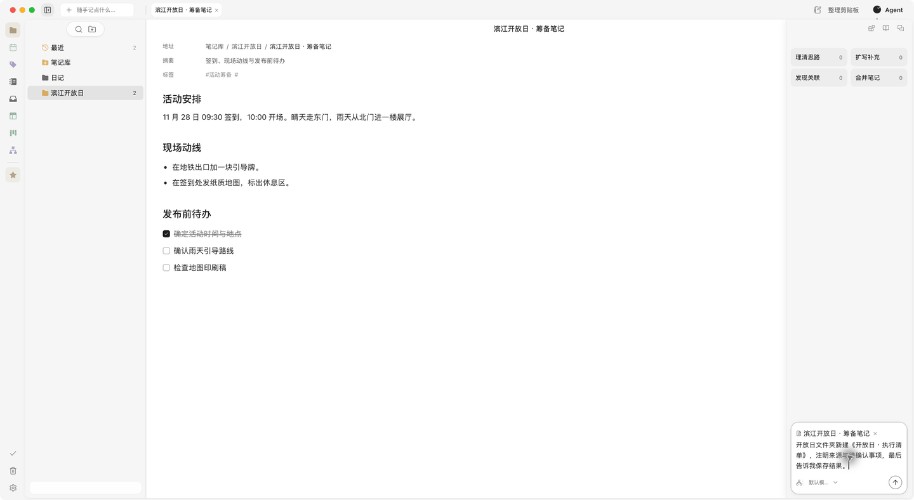
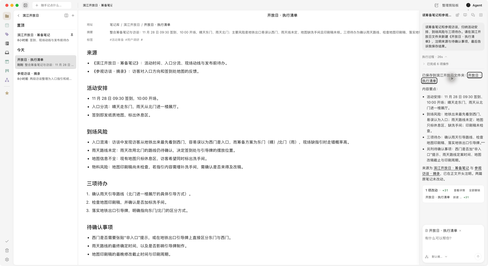

<div align="center">
  
  <h1>Tucklet</h1>
  <p><strong>把笔记用起来。</strong></p>
  <p>一个围绕个人笔记工作的知识管理 Agent。<br />从记录、阅读与整理，到找到答案、形成清单和继续行动。</p>
  <p>
    
    
    
    <a href="LICENSE"></a>
  </p>
  <p><a href="#产品预览">产品预览</a> · <a href="#这个仓库提供什么">公开内容</a> · <a href="#本地运行">本地运行</a> · <a href="docs/frontend.md">前端实现导读</a></p>
</div>

## 为什么做 Tucklet

笔记越来越多，重新找到上下文却越来越难。活动安排散在几篇记录里，讨论之后仍要手动提取待办，问过 AI 的结果又停留在聊天窗口。

Tucklet 希望把这些动作接起来：以自己的笔记为上下文，让阅读、整理和后续行动发生在同一个工作空间里。Agent 的结果可以保存回笔记库，成为下一次工作的起点。

## 产品预览

以下图片与动图来自完整 macOS 产品，展示真实产品流程；本仓库提供的可运行内容见下方「公开内容」。

### 从两篇笔记，到一份执行清单

读取活动筹备笔记与参观访谈，归纳到场风险和待办，再将执行清单存回笔记库。



### 笔记、正文与 Agent，放在同一个工作空间

左侧定位资料，中间阅读与编辑，右侧跟进 Agent 的执行过程和保存结果。生成的清单保留来源与待确认事项，便于继续检查和推进。



<details>
<summary>这个流程关注的产品细节</summary>

- **围绕已有资料工作**：问题与笔记放在同一上下文里，减少来回复制。
- **结果进入知识库**：整理后的内容可以成为新的笔记，而不只是一条聊天回复。
- **过程可见**：用户能看到执行过程、保存结果与对应内容。
- **保留后续判断空间**：来源、风险和待确认事项分别呈现，方便人工复核。

</details>

## 这个仓库提供什么

**Tucklet-open 是 Tucklet 的部分前端开源仓库。** 包含产品展示页面和从桌面端提取的独立交互组件，可在浏览器中运行。

| 模块 | 公开内容 | 阅读入口 |
| --- | --- | --- |
| 产品展示 | 响应式页面、截图展示、动效偏好适配与 SVG 图标 | [LandingPage](components/LandingPage.tsx) |
| 笔记大纲 | 标题提取、章节跟随、浮层目录与滚动跳转 | [NoteOutlineRail](src/components/editor-panel/NoteOutlineRail.tsx) |
| 字号控制 | 受控字号、边界限制、点击外部关闭与焦点恢复 | [NoteFontSizeControl](src/components/NoteFontSizeControl.tsx) |
| 看板输入 | 本地草稿、回车与失焦提交、中文输入法兼容 | [KanbanDraftInput](src/components/kanban/KanbanDraftInput.tsx) |
| 组件演示 | 使用独立示例数据串联上述交互 | [ComponentPlayground](components/ComponentPlayground.tsx) |

完整产品使用 React / TypeScript 构建桌面界面，并通过 Tauri / Rust 接入原生能力。当前公开工程以 Next.js 组织展示页与组件演示，**不包含完整桌面应用、Agent 执行引擎、同步与存储实现、知识检索后端或模型服务配置**。

演示页中的数据只保存在当前页面内存中，刷新后恢复；不发起模型请求，也不会读取本机笔记。产品截图中的 Agent 功能不在此演示页中执行。

## 本地运行

需要 Node.js **22.22.2 或更新版本**及 npm。

```bash
git clone https://github.com/youwan2y/Tucklet-open.git
cd Tucklet-open
npm ci
npm run dev
```

打开：

- `http://localhost:3000` — 产品介绍与流程展示。
- `http://localhost:3000/playground` — 笔记大纲、字号控制与看板输入演示。

无需配置环境变量、数据库、API Key 或原生工具链。

```bash
npm run check   # TypeScript 静态检查
```

## 从哪里开始读代码

```text
app/
├── page.tsx                   产品展示入口
├── globals.css                页面样式与响应式布局
└── playground/                组件演示入口与布局
components/
├── LandingPage.tsx            产品叙事、媒体与导航
└── ComponentPlayground.tsx    示例数据与组件状态
src/
├── components/
│   ├── NoteFontSizeControl.tsx
│   ├── ControlIcon.tsx        公开组件使用的最小图标适配
│   ├── editor-panel/          大纲模型与交互组件
│   └── kanban/                草稿输入组件
└── styles/components.css      提取的组件样式
public/                        产品标识与展示素材
docs/frontend.md               实现取舍、边界与提取说明
```

建议先从 [组件演示](components/ComponentPlayground.tsx) 看状态如何传入，再读 [大纲组件](src/components/editor-panel/NoteOutlineRail.tsx) 和 [草稿输入](src/components/kanban/KanbanDraftInput.tsx)。更具体的交互取舍见 [前端实现导读](docs/frontend.md)。

## 一些实现取舍

- **把交互组件与数据能力分开**：字号由 `value / onChange` 控制，草稿通过 `onCommit` 交给外层处理；在公开工程中用示例状态接入，保留组件本身的交互逻辑。
- **让目录轻一点**：滚动监听采用被动监听，并通过 `requestAnimationFrame` 合并同一帧的更新；展开目录使用 Portal，避免被正文滚动容器裁切。
- **输入时保留草稿**：编辑期间不让不同的外部值直接覆盖当前待提交文字；中文输入法组合状态下按回车不会触发提交。
- **照顾键盘与动效偏好**：字号面板支持 Escape 关闭并恢复触发器焦点；大纲提供可聚焦按钮与当前章节语义；产品动图在减少动态效果偏好下显示静态图。

这些组件展示的是前端交互设计。持久化、网络失败处理与多端一致性属于其他层，不由本仓库中的演示状态提供保证。

## 反馈与许可

欢迎通过 [Issues](https://github.com/youwan2y/Tucklet-open/issues) 交流公开组件的问题与改进建议。提交问题时请附操作步骤、预期行为与浏览器版本，避免上传个人笔记或访问凭据。

本仓库源代码采用 [MIT License](LICENSE)。Tucklet 名称、标识、产品截图与录屏的使用范围见 [素材说明](ASSETS.md)。
