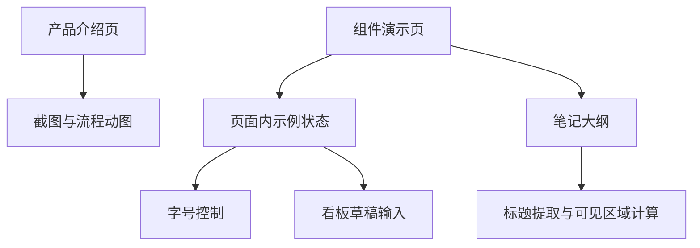

# 前端实现导读

本仓库提供产品展示前端，以及从 Tucklet 桌面界面提取的三个独立交互组件。阅读代码时，可以从以下依赖关系开始：

## 笔记大纲：把文档结构与滚动位置连接起来

`outlineModel.ts` 从 Markdown 文本中提取一至三级标题，跳过以三个反引号标记的代码区块，并清理常见行内标记。它是面向现有内容约定的轻量解析器，不是完整 Markdown 解析器：不处理 Setext 标题、波浪号代码围栏等所有语法。

`NoteOutlineRail.tsx` 负责 UI 行为：

- 正文容器通过 `scrollRef` 显式传入，组件不接触数据接口。
- 监听滚动时以 `requestAnimationFrame` 合并更新，根据标题与容器顶部的位置更新当前章节。
- 简略大纲与展开目录共享当前章节和悬停状态；浮层用 `createPortal` 渲染到 `document.body`。
- 悬停离开时延迟关闭，留出鼠标从短线移动到目录面板的时间。
- 退出组件时清理监听、动画帧和关闭计时器。

集成时，渲染正文中的 `h1 / h2 / h3` 必须与传入大纲的标题顺序一致，并放在 `.editor-rich-content-surface` 中。当前组件以索引建立对应关系，不适合直接用于标题集合独立异步变化的文档。

## 字号控制：由父组件决定偏好如何保存

`NoteFontSizeControl.tsx` 只持有面板开关状态，实际字号通过 `value` 传入，变化经 `onChange` 通知外层。演示页调整正文样式；其他项目可以选择接入自己的本地偏好设置。

面板支持点击外部关闭、焦点离开关闭，以及 Escape 关闭后恢复触发器焦点。按钮限制在 13–30 的范围内。

提取时保留交互代码，将全局字号常量内联到当前模块，并用 `ControlIcon.tsx` 替换完整产品的图标注册表，避免连带引入其他功能。

## 看板输入：草稿生命周期与提交生命周期分开

`KanbanDraftInput.tsx` 内部维护当前输入草稿，失焦时调用 `onCommit`；普通回车触发失焦，组合输入中的回车保持编辑。组件不会因为编辑中的不同外部值而直接替换待提交文字。

待提交记录同时保留原提交回调，避免在等待外部更新期间悄然切换提交上下文。相同值从外部回传后，组件将其视为草稿确认。

这个组件不提供网络提交成功与失败的协议。接入异步数据源时，外层仍需负责错误反馈、重试与版本校验；演示页只做同步的内存状态更新。

## 产品展示：内容、素材与响应式布局

`LandingPage.tsx` 基于产品展示页面提取，保留实际产品图片和流程说明。公开版本增加组件演示入口，将主要行动入口改为 GitHub 源码与演示页面。

图片配置尺寸以减少布局偏移；动图显式保留原始格式，在 `prefers-reduced-motion` 下切换静态图。页面使用 CSS 媒体查询适配不同宽度，包含跳到正文的键盘导航入口。

## 提取边界

| 来源模块 | 公开版本的处理 |
| --- | --- |
| 产品展示页面 | 提取页面、样式、SVG 和经过筛选的产品素材；调整导航与行动入口 |
| 大纲组件与模型 | 保留组件逻辑，补充 Next.js 客户端边界 |
| 字号控件 | 保留交互；内联字号范围、替换图标依赖、补充客户端边界 |
| 看板草稿输入 | 保留组件逻辑，补充客户端边界 |
| 桌面编辑器样式 | 仅提取大纲与字号相关规则，由演示页补齐所需 CSS 变量 |
| 组件演示 | 为公开版本新增；使用专门编写的示例笔记与页面内状态 |

公开工程不引入桌面 IPC、模型请求、同步实现或真实数据目录。产品展示图说明完整产品的体验，组件演示说明此仓库实际可以运行的部分。

## 检查范围

此公开版本进行轻量静态检查，包括 TypeScript 检查、语法解析、引用路径与发布文件检查。初次提取未执行生产构建或浏览器交互验收；文档中的交互说明依据组件实现，不代表已经完成浏览器实测。
